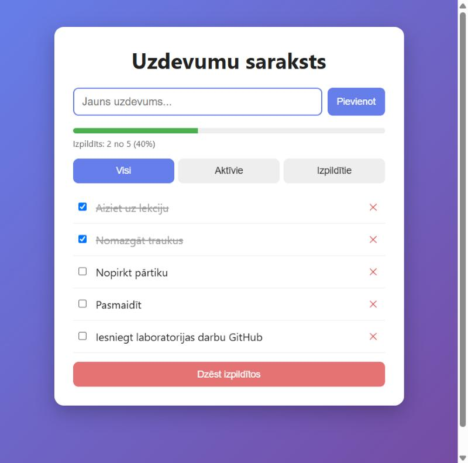

# Uzdevumu saraksts (ToDo, React)

## Projekta pase

| Lauks | Vērtība |
|---|---|
| Students | Artūrs Fedkins, st85543, 4302BNL |
| Nosaukums | Uzdevumu saraksts (ToDo) |
| Apraksts | Uzdevumu pārvaldības lietotne: pievienot, atzīmēt kā izpildītu, dzēst, filtrēt uzdevumus. Dinamiskie elementi: animācijas, progresa josla, saglabāšana localStorage. |
| Ietvars | React 18 + Vite |
| GitHub | https://github.com/arrt11k/webapp-lab2-todo |

## Palaišana lokāli

```bash
npm install
npm run dev
```
Atver http://localhost:5173

## Ekrānuzņēmums


